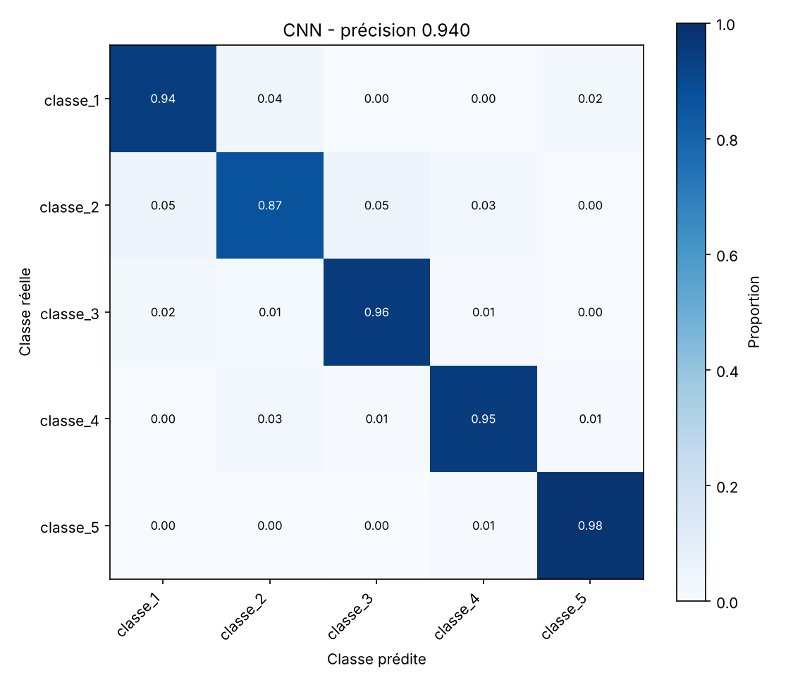
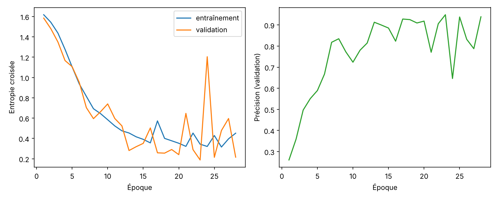

# Classification de fragments d'ADN par CNN sur images CGR


> *Alignment-free taxonomic classification of DNA fragments: FCGR images fed
> to a convolutional network, benchmarked against a linear baseline.*

À quelle espèce appartient un fragment d'ADN de 1 000 paires de bases, sans
l'aligner sur aucune référence ? Chaque fragment est converti en image FCGR
64 x 64 (fréquences des 4 096 hexamères, voir le projet
[cgr-genomic-signatures](https://github.com/AdelTouabi0/cgr-genomic-signatures)), puis classé par un
réseau de neurones convolutif.

Le CNN est systématiquement **comparé à une régression logistique** sur la
même image aplatie : un modèle profond n'a d'intérêt que s'il fait mieux
qu'une référence simple.

## Pipeline

```
génomes ──► fragments aléatoires ──► images FCGR (k=6) ──► CNN
 (1 000 pb, équilibrés)               └──► régression logistique (référence)
```

- Découpage stratifié 70 / 15 / 15 (entraînement / validation / test),
  standardisation calculée sur l'entraînement uniquement.
- CNN : 3 blocs convolution, normalisation par lot, ReLU, pooling moyen,
  puis classifieur dense (environ 550 000 paramètres), optimiseur AdamW et
  arrêt anticipé sur la perte de validation.
- **Choix d'architecture** : contrairement à une photo, la position d'un
  pixel FCGR désigne un k-mer précis. Un pooling global rendrait le modèle
  invariant à la position et effacerait cette information ; les cartes de
  caractéristiques sont donc aplaties. Le pooling moyen (et non max) préserve
  mieux des comptages très creux.

## Validation sur génomes simulés

Avant d'utiliser de vrais génomes, la méthode est validée sur 5 classes
simulées par des **chaînes de Markov d'ordre 3** partageant une matrice de
transition « ancestrale » (divergence de 5 % entre classes) :

```bash
python -m cgr_cnn.train --simulate -o results/simulated
```

| Modèle | Précision (test, 1 125 fragments) |
|---|---|
| Régression logistique (image aplatie) | **0,991** |
| CNN | 0,940 |




**Interprétation.** La référence linéaire l'emporte, et c'est attendu : pour
une chaîne de Markov d'ordre 3, la log-vraisemblance d'une séquence est
une fonction *linéaire* des comptages de 4-mers, eux-mêmes contenus dans
l'image FCGR k=6. Le problème simulé est donc linéairement séparable par
construction, et la régression logistique est quasiment le modèle optimal.
Les courbes montrent aussi une validation instable : un planificateur du
taux d'apprentissage est une amélioration simple à tester.

La vraie question (le CNN capte-t-il des motifs non linéaires présents dans
de vrais génomes ?) se tranche sur données réelles, ci-dessous.

## Données réelles

```bash
python scripts/download_bacteria.py --email prenom.nom@exemple.fr
python -m cgr_cnn.train --data data/real -o results/real
```

Cinq génomes bactériens de référence : *E. coli* K-12, *B. subtilis* 168,
*S. aureus* NCTC 8325, *M. tuberculosis* H37Rv, *P. aeruginosa* PAO1.
Toute autre structure `data/<classe>/*.fasta` fonctionne.

*Résultats sur données réelles : à compléter après exécution.*

## Installation

```bash
git clone https://github.com/AdelTouabi0/cgr-cnn-classifier.git
cd cgr-cnn-classifier
python -m venv .venv && source .venv/bin/activate
pip install torch --index-url https://download.pytorch.org/whl/cpu
pip install -r requirements.txt
pytest -q
```

## Structure

```
cgr_cnn/
├── fcgr.py    # images FCGR vectorisées
├── data.py    # génomes réels ou simulés, échantillonnage des fragments
├── model.py   # architecture du CNN
└── train.py   # entraînement, référence linéaire, figures, métriques
scripts/download_bacteria.py
tests/
```

## Références

- Rizzo R. *et al.* (2016). A deep learning approach to DNA sequence
  classification. *CIBB 2015*, LNCS 9874, 129-140.
- Jeffrey H. J. (1990). Chaos game representation of gene structure.
  *Nucleic Acids Research*, 18(8), 2163-2170.

## Contexte

Projet personnel prolongeant le projet universitaire
`cgr-genomic-signatures`. Développé avec l'assistance d'outils d'IA (Claude).

## Auteur

Adel Touabi, Master 1 Bio-informatique, Université Paris Cité.
